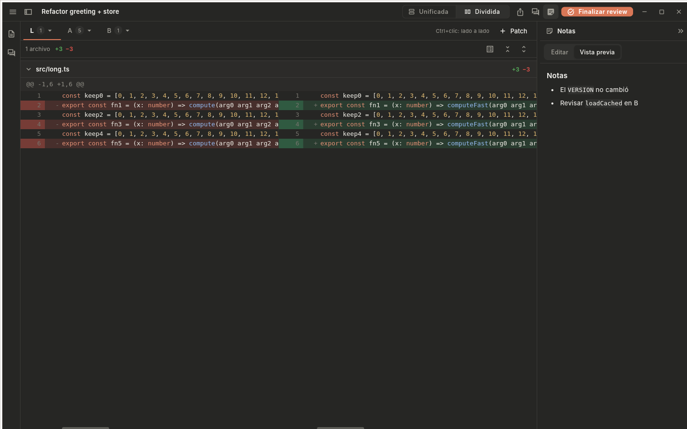
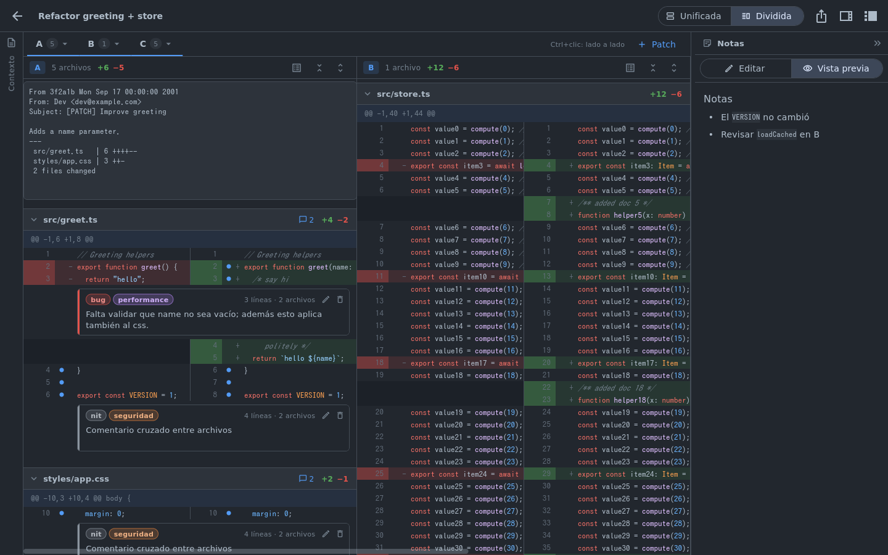
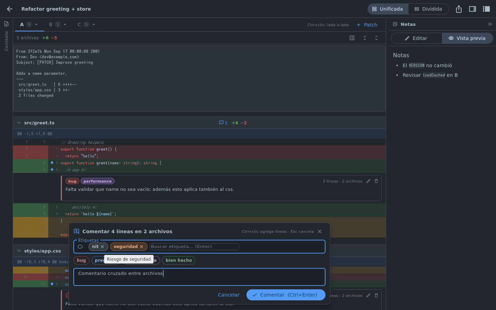
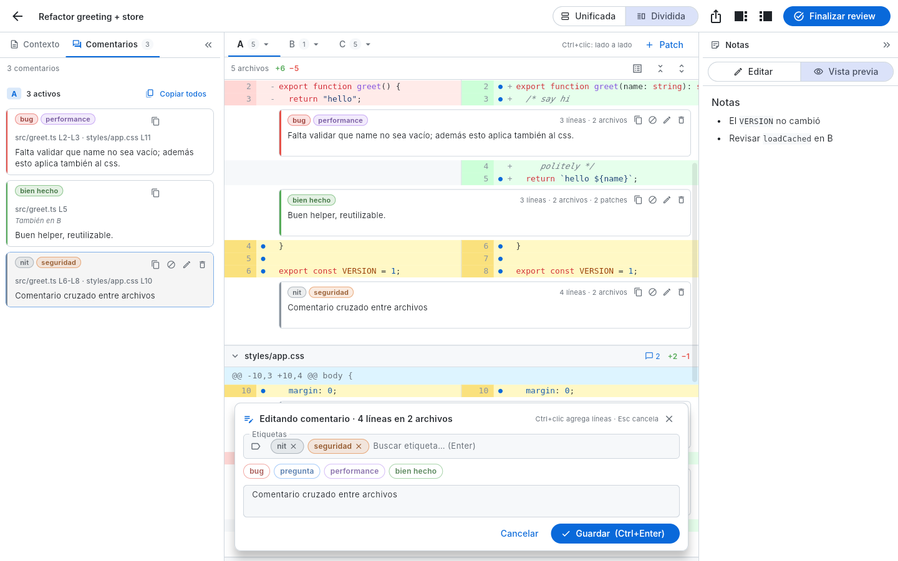
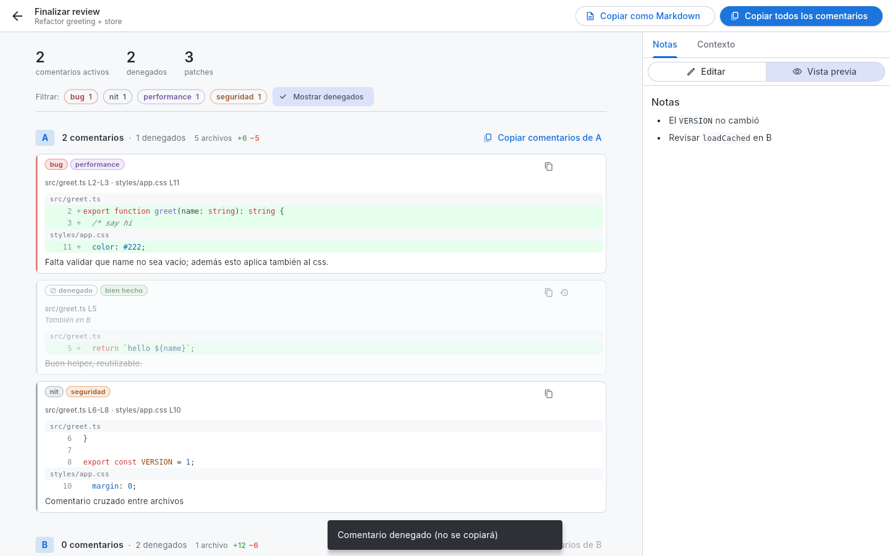

# Patchdeck

Aplicación de escritorio nativa para **Linux y Windows** (Flutter/Dart) para **analizar git patches** estilo code review de GitHub:
pegas uno o varios patches, seleccionas líneas, las comentas con etiquetas y llevas tus notas en Markdown.



## Funcionalidades

- **Panel lateral de reviews** (como la lista de conversaciones de un chat): siempre disponible, con búsqueda,
  crear / renombrar / eliminar. Se colapsa al abrir una review y se vuelve a mostrar con el botón de panel de
  la barra superior. El menú ≡ tiene *Nueva review* y *Configuración*.
- **Barra de título propia, fina** (sin la barra nativa gruesa): arrastrar para mover, doble clic para maximizar,
  botones discretos de minimizar / maximizar / cerrar.
- **Workspace** por review:
  - Columna izquierda (colapsable, redimensionable y animada) con dos pestañas:
    - **Contexto**: Markdown libre, p. ej. la descripción del PR.
    - **Comentarios**: los comentarios de los patches visibles, agrupados por patch y ordenados por posición.
      Clic en uno → el diff salta a esas líneas y lo abre en edición. Cada comentario tiene *copiar*, y cada
      patch un *Copiar todos*.
  - Columna derecha **Notas** (colapsable y redimensionable): anotaciones libres en Markdown con vista previa.
  - **Varios patches por review**, cada uno en su pestaña, nombrados `A`, `B`, `C`, … `Z`, `AA`… (renombrables).
  - **Varios patches lado a lado**: `Ctrl+clic` en una pestaña (o menú ▾ → *Ver lado a lado*). Con dos patches
    cada uno ocupa la mitad; con tres o más se desbordan horizontalmente y se navega con `Shift+rueda`.
  - **Scroll horizontal** del código (Shift+rueda, rueda/trackpad horizontal o la barra inferior). En vista
    dividida ambos lados se mueven juntos; los encabezados de archivo y hunk quedan fijos. Al llegar al borde,
    Shift+rueda pasa al siguiente patch (sobre la barra superior de un patch, siempre mueve entre patches).
  - Vista **unificada** o **dividida** (split).
  - **Resaltado de sintaxis** para JavaScript / TypeScript / CSS (SCSS/LESS básico).
  - Soporta `git diff`, `git show`, `git format-patch` (muestra el mensaje del commit) y `diff -u`; renombres,
    archivos nuevos/eliminados y binarios.
- **Selección de líneas estilo GitHub**:
  - clic en el `+` de una línea;
  - arrastrar el `+` para seleccionar un rango (con auto-scroll en los bordes);
  - `Ctrl+clic` / `Ctrl+arrastrar` para agregar (o quitar) líneas sueltas, **incluso de otros archivos y otros patches**;
  - `Shift+clic` extiende desde la última línea marcada.
- **Comentarios**: al seleccionar aparece el editor; primero el input de **etiquetas** (escribe para filtrar,
  `Enter` agrega, `Backspace` quita), luego el texto. `Ctrl+Enter` guarda, `Esc` cancela. Un comentario aplica a
  todas las líneas seleccionadas de todos los archivos. Clic en un comentario para editarlo.
- **Copiar**: un comentario se copia como `[etiquetas] archivo L3-L5 · otro.css L11: texto`; "copiar todos" los
  une con una línea en blanco. Los comentarios **denegados** nunca se copian.
- **Denegar**: marca un comentario como descartado sin borrarlo; se muestra apagado y tachado en todos lados.
- **Finalizar review**: resumen con estadísticas, filtro por etiqueta, todos los comentarios por patch con un
  extracto del código al que apuntan, y acciones de editar / denegar / eliminar / copiar. Las notas y el contexto
  quedan a la derecha, editables. Desde ahí se copian todos los comentarios o la review completa en Markdown.
- **Fuente del sistema**: la UI y el código usan las fuentes del escritorio (GNOME `gsettings`, KDE
  `kdeglobals`, o los alias `sans-serif` / `monospace` de fontconfig).
- **Configuración** (popup con buscador): tema con vista previa del diff (Grafito, Lino, Oscuro, Claro,
  Medianoche, Arena, Bosque), vista por defecto, fuente y tamaño del código, resaltado on/off, **etiquetas**
  (título, descripción, color; reordenables) y dónde se guardan los datos.
- **Estética sobria** tipo shadcn: superficies neutras, bordes de 1 px, sin sombras ni efectos de Material.
  Se ve igual en Linux y en Windows (Flutter dibuja toda la interfaz; sólo cambia la fuente del sistema).

| Patches lado a lado | Editor de comentario |
|---|---|
|  |  |
| **Pestaña de comentarios** | **Finalizar review** |
|  |  |

## Descargas

En [Releases](https://github.com/horarodriguezz/patchdeck/releases) hay builds listos:

| Sistema | Archivo |
|---|---|
| Windows 10/11 | `PatchdeckSetup-<versión>.exe` (instalador, sin admin) o `…-windows-x64-portable.zip` |
| Linux x64 | `patchdeck-<versión>-linux-x64.tar.gz` (binario precompilado) |

> En Windows el instalador no está firmado: la primera vez SmartScreen muestra *"Windows protegió tu PC"* →
> **Más información → Ejecutar de todas formas**.

Para publicar una versión: `git tag v0.3.0 && git push origin v0.3.0` (el workflow *Release* compila y sube todo).

## Instalación (Fedora / Ubuntu)

Un solo script que funciona en ambas: instala las dependencias de compilación (`dnf` o `apt`, pide `sudo`),
descarga Flutter si no lo tienes (en `~/.local/share/patchdeck-sdk`, sólo para compilar), compila y
instala la app con su **ícono** y su **lanzador `.desktop`**, así aparece en el menú de aplicaciones.

```bash
curl -fsSL https://raw.githubusercontent.com/horarodriguezz/patchdeck/main/scripts/install.sh | bash
```

Volver a ejecutar el mismo comando **actualiza** la app (el código se guarda en
`~/.local/share/patchdeck-sdk/src`). Para pasar opciones: `curl … | bash -s -- --system`.

Desde un clon del repo también vale `./scripts/install.sh`.

Opciones:

| Comando | Qué hace |
|---|---|
| `./scripts/install.sh` | Instala para tu usuario en `~/.local` (binario, `.desktop`, íconos) |
| `./scripts/install.sh --system` | Instala para todo el sistema en `/usr/local` |
| `./scripts/install.sh --skip-deps` | No toca paquetes del sistema (ya los tienes) |
| `./scripts/install.sh --uninstall` | Desinstala (tus reviews y configuración se conservan) |


### Compilar a mano

Requisitos: Flutter (stable, ≥ 3.32 · Dart ≥ 3.8) y el toolchain nativo (clang, cmake, ninja, pkg-config, GTK 3).

```bash
make deps    # dependencias del sistema (Fedora o Ubuntu)
```

```bash
make build   # binario en build/linux/x64/release/bundle/patchdeck
```

Otros: `make run` (modo debug), `make test`, `make analyze`, `make install` / `make uninstall`.

## Dónde se guardan los datos

En Windows todo va en `%APPDATA%\Patchdeck\` (`settings.json` y `reviews\`). En Linux, siguiendo la
especificación XDG:

| Qué | Ruta |
|---|---|
| Configuración (temas, etiquetas) | `$XDG_CONFIG_HOME/patchdeck/settings.json` (por defecto `~/.config/patchdeck/settings.json`) |
| Reviews | `$XDG_DATA_HOME/patchdeck/reviews/<id>.json` (por defecto `~/.local/share/patchdeck/reviews/`) |
| Índice de reviews | `~/.local/share/patchdeck/reviews/index.json` |

La configuración es JSON legible y editable a mano. Las reviews van aparte porque pueden ser grandes
(contienen los patches) y así la configuración se puede versionar o sincronizar sin arrastrarlas. Las escrituras
son atómicas (archivo temporal + `rename`) y con debounce.

## Arquitectura y rendimiento

```
lib/
  models/      Review, PatchEntry, ReviewComment, LineAnchor, ReviewLabel, AppSettings
  diff/        diff_parser (unified diff → modelo), syntax (tokenizer JS/TS/CSS), diff_layout (filas virtualizadas)
  services/    rutas XDG, JSON atómico, repositorios de settings y reviews
  state/       controllers (settings, reviews, workspace, selección), PatchModel, export Markdown
  theme/       temas y DiffTheme (ThemeExtension con colores de diff y sintaxis)
  ui/          shell/ (sidebar, barra de título), settings/, workspace/, diff/, comments/, finalize/, common/
```

- **Parseo y tokenizado fuera del hilo de UI** (`Isolate.run`) para patches grandes; se hace una sola vez.
- **Virtualización total**: el diff (todos los archivos) se aplana en una lista de filas de **altura conocida**
  (`itemExtentBuilder`), así sólo existen widgets para lo visible y saltar a un archivo, o mapear el puntero a
  una fila durante el arrastre, es una búsqueda binaria sobre offsets precalculados.
  Los panes lado a lado también se virtualizan horizontalmente.
- El layout se cachea y sólo se recalcula al cambiar modo, fuente, archivos colapsados o comentarios.
- Los comentarios se anclan por `(patch, archivo, línea vieja/nueva)`, no por índice, para que sean estables.
- Líneas gigantes (bundles minificados) se truncan a 2000 caracteres en pantalla.

Probado con un patch de ~3.7 MB / 100k líneas / 200 archivos.
