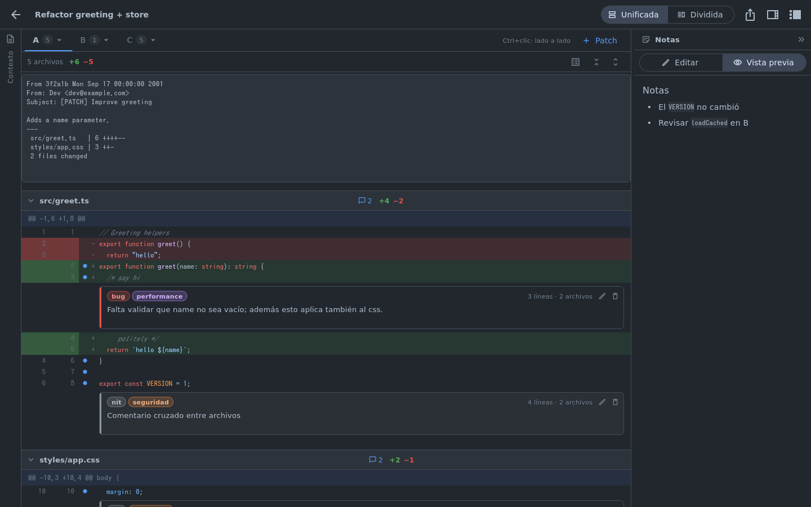

# Patchdeck

Aplicación nativa para Linux (Flutter/Dart) para **analizar git patches** estilo code review de GitHub:
pegas uno o varios patches, seleccionas líneas, las comentas con etiquetas y llevas tus notas en Markdown.



## Funcionalidades

- **Reviews**: la pantalla inicial lista tus reviews (crear, renombrar, eliminar).
- **Workspace** por review:
  - Columna izquierda **Contexto** (colapsable y redimensionable): Markdown libre, p. ej. la descripción del PR.
  - Columna derecha **Notas** (colapsable y redimensionable): anotaciones libres en Markdown con vista previa.
  - **Varios patches por review**, cada uno en su pestaña, nombrados `A`, `B`, `C`, … `Z`, `AA`… (renombrables).
  - **Varios patches lado a lado**: `Ctrl+clic` en una pestaña (o menú ▾ → *Ver lado a lado*). Con dos patches
    cada uno ocupa la mitad; con tres o más se desbordan horizontalmente y se navega con `Shift+rueda`.
  - Vista **unificada** o **dividida** (split).
  - **Resaltado de sintaxis** para JavaScript / TypeScript / CSS (SCSS/LESS básico).
  - Soporta `git diff`, `git show`, `git format-patch` (muestra el mensaje del commit) y `diff -u`; renombres,
    archivos nuevos/eliminados y binarios.
- **Selección de líneas estilo GitHub**:
  - clic en el `+` de una línea;
  - arrastrar el `+` para seleccionar un rango (con auto-scroll en los bordes);
  - `Ctrl+clic` / `Ctrl+arrastrar` para agregar (o quitar) líneas sueltas, **incluso de otros archivos y otros patches**;
  - `Shift+clic` extiende desde la última línea marcada.
- **Comentarios**: al seleccionar aparece el editor; primero el input de **etiquetas** (escribe para filtrar,
  `Enter` agrega, `Backspace` quita), luego el texto. `Ctrl+Enter` guarda, `Esc` cancela. Un comentario aplica a
  todas las líneas seleccionadas de todos los archivos. Clic en un comentario para editarlo.
- **Exportar**: botón de compartir → copia la review (contexto, comentarios con ubicaciones, notas) como Markdown.
- **Configuración**: temas (Oscuro, Claro, Medianoche, Arena, Bosque), tamaño de fuente del código, vista por
  defecto, resaltado on/off, y **etiquetas** (título, descripción, color; reordenables).

| Patches lado a lado | Editor de comentario |
|---|---|
|  |  |

## Compilar desde el código fuente

Requisitos: Flutter (stable, ≥ 3.32 · Dart ≥ 3.8) y el toolchain nativo de Linux (clang, cmake, ninja, pkg-config, GTK 3).

### Fedora

```bash
sudo dnf install -y clang cmake ninja-build pkgconf-pkg-config gtk3-devel xz-devel git curl unzip xz which
```

### Ubuntu / Debian

```bash
sudo apt-get install -y clang cmake ninja-build pkg-config libgtk-3-dev liblzma-dev git curl unzip xz-utils
```

(O simplemente `make deps`, que detecta la distro.)

### Flutter

```bash
git clone --depth 1 -b stable https://github.com/flutter/flutter.git ~/.local/flutter
```

```bash
export PATH="$HOME/.local/flutter/bin:$PATH"
```

### Build e instalación

```bash
make build      # binario en build/linux/x64/release/bundle/patchdeck
```

```bash
make install    # instala en ~/.local (binario, .desktop e icono). PREFIX=/usr/local para sistema
```

Otros: `make run` (modo debug), `make test`, `make analyze`, `make uninstall`.

## Dónde se guardan los datos

Siguiendo la especificación XDG:

| Qué | Ruta |
|---|---|
| Configuración (temas, etiquetas) | `$XDG_CONFIG_HOME/patchdeck/settings.json` (por defecto `~/.config/patchdeck/settings.json`) |
| Reviews | `$XDG_DATA_HOME/patchdeck/reviews/<id>.json` (por defecto `~/.local/share/patchdeck/reviews/`) |
| Índice de reviews | `~/.local/share/patchdeck/reviews/index.json` |

La configuración es JSON legible y editable a mano. Las reviews van aparte porque pueden ser grandes
(contienen los patches) y así la configuración se puede versionar o sincronizar sin arrastrarlas. Las escrituras
son atómicas (archivo temporal + `rename`) y con debounce.

## Arquitectura y rendimiento

```
lib/
  models/      Review, PatchEntry, ReviewComment, LineAnchor, ReviewLabel, AppSettings
  diff/        diff_parser (unified diff → modelo), syntax (tokenizer JS/TS/CSS), diff_layout (filas virtualizadas)
  services/    rutas XDG, JSON atómico, repositorios de settings y reviews
  state/       controllers (settings, reviews, workspace, selección), PatchModel, export Markdown
  theme/       temas y DiffTheme (ThemeExtension con colores de diff y sintaxis)
  ui/          home/, settings/, workspace/, diff/, common/
```

- **Parseo y tokenizado fuera del hilo de UI** (`Isolate.run`) para patches grandes; se hace una sola vez.
- **Virtualización total**: el diff (todos los archivos) se aplana en una lista de filas de **altura conocida**
  (`itemExtentBuilder`), así sólo existen widgets para lo visible y saltar a un archivo, o mapear el puntero a
  una fila durante el arrastre, es una búsqueda binaria sobre offsets precalculados.
  Los panes lado a lado también se virtualizan horizontalmente.
- El layout se cachea y sólo se recalcula al cambiar modo, fuente, archivos colapsados o comentarios.
- Los comentarios se anclan por `(patch, archivo, línea vieja/nueva)`, no por índice, para que sean estables.
- Líneas gigantes (bundles minificados) se truncan a 2000 caracteres en pantalla.

Probado con un patch de ~3.7 MB / 100k líneas / 200 archivos.
